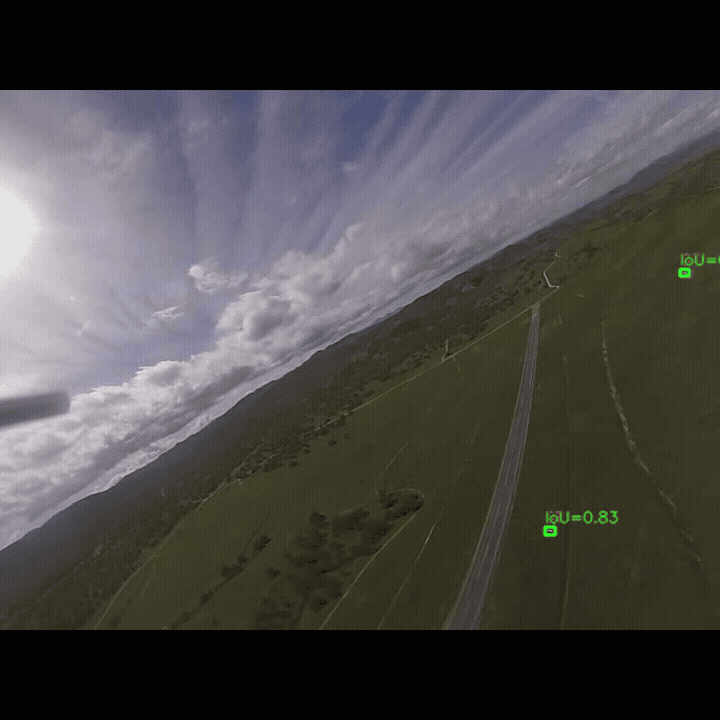
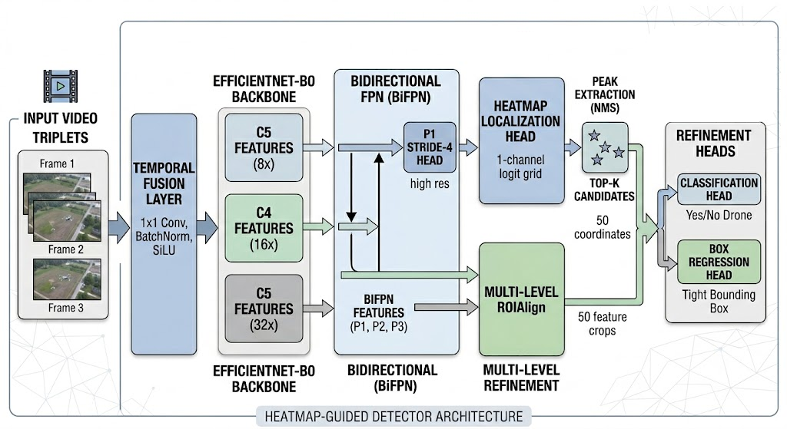

# Drone-to-Drone Detection

Custom sparse heatmap detector on the NPS-Drones dataset, benchmarked against YOLO and RT-DETR baselines.



## Why this matters

As drones become more common in both commercial and military settings, the ability for one drone to detect another in real-time is critical for collision avoidance, swarm coordination, and counter-drone systems. Most detection research assumes a ground-based camera with a fixed background. Drone-to-drone detection is fundamentally different and considerably harder.

## Problem

- **Tiny targets.** At 640x640 the drone occupies 4-8 pixels. Standard FPN strides (8, 16, 32) leave almost no spatial resolution to localize something this small.
- **Ego-motion.** The camera is mounted on a flying platform, so the entire background shifts between frames. Motion cues that work well for fixed cameras become noisy and unreliable.
- **No texture.** At this scale the drone is a blob. No edges, color patterns, or shape features for a CNN to latch onto.
- **Class imbalance.** One drone against millions of background pixels. Dense anchor heads generate tens of thousands of proposals, almost all negative.

## Our approach



Instead of classifying every anchor location, we first narrow the search to a sparse set of candidates using a CenterNet-style heatmap, then refine only those ~50 candidates with ROIAlign and an MLP. This avoids wasting compute on obvious background and keeps inference fast.

Full model definition in `model.py`:

- EfficientNet-B0 backbone, features at 3 scales
- TemporalFusion: 1x1 conv over T=3 concatenated frame features per scale
- 3-layer BiFPN, output P1 at stride 4 (160x160)
- Motion maps: absolute frame differences fused into the heatmap head (YOLOMG-style)
- Peak extraction: sigmoid, 3x3 max-pool NMS, top-50 candidates
- Multi-level ROIAlign on P1/P2/P3 (11x11 grid) fed into MLP for objectness and box deltas

Phase 3 improvements: adaptive Gaussian sigma per object size, data-driven anchor (5.93 px from training labels), DIoU-based proposal matching.

## What we achieved

Phase 3 reaches **0.81 AP@50** and **0.81 F1** at **49 FPS** on a Tesla T4, staying real-time while matching the accuracy of earlier anchor-based variants at lower compute cost.

Custom model progression (T=3 triplets, Tesla T4):

| Variant | AP@50 | F1 | FPS |
|---------|-------|----|-----|
| v1 (no motion) | 0.609 | 0.753 | 49.2 |
| v2 (3-anchor) | 0.649 | 0.748 | 41.3 |
| Phase 1 | 0.633 | 0.736 | 47.4 |
| **Phase 3** | **0.81** | **0.812** | **49.0** |

Baselines for comparison (every 4th test frame, Tesla T4):

| Model | AP@50 | F1 | FPS |
|-------|-------|----|-----|
| YOLO11n | 0.673 | 0.663 | 261.6 |
| YOLO11s | 0.729 | 0.694 | 154.2 |
| YOLO11m | 0.718 | 0.688 | 55.2 |
| YOLO12s | 0.854 | 0.862 | 117.7 |
| RT-DETRv1 | 0.913 | 0.893 | 22.3 |

## Future work

- Train on multi-class drone datasets (different drone types, sizes, and orientations)
- Replace the single data-driven anchor with a learned anchor-free decoding head
- Experiment with longer temporal windows (T=5 or T=7) to capture slower-moving targets
- Integrate optical flow as a richer motion signal, especially for ego-motion compensation
- Test on onboard hardware (Jetson Orin or similar) for embedded deployment

## Setup

```bash
pip install -r requirements.txt

# shape check, no data needed
python model.py
```
